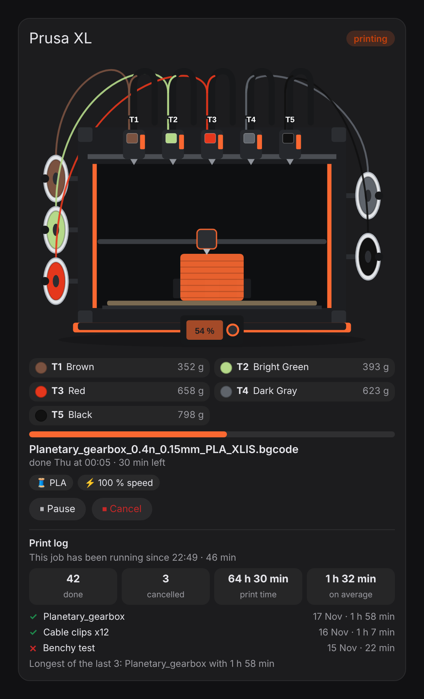

# Prusa XL Card

Your Prusa XL as a live drawing in Home Assistant: the tool changer with up to five heads, the filament on each head in its real colour, the print growing on the bed, progress, finish time and the pause / resume / cancel buttons. When the printer is off, the card shows it switched off.



- **PrusaLink:** works with the built-in [PrusaLink integration](https://www.home-assistant.io/integrations/prusalink/), with English or German entity names.
- **Spools on the tool heads (optional):** with the [Spoolman integration](https://github.com/Disane87/spoolman-homeassistant), each head shows the loaded spool. Tap a head to load another spool, subtract what a print used, or set the price of the spool; the card estimates what the print cost. The old spool goes back to your storage location first.
- **Print log (optional):** number of finished and cancelled prints, total and average print time, and the last five jobs with a thumbnail.
- **Finish sounds:** three short sounds in [`sounds/`](sounds) that you can play on a speaker when a print is done.

UI texts are available in **English and German** and follow the user's language. The card works for other PrusaLink printers too; set `tools: 1` for a single-head printer.

## Installation

**HACS** (recommended): HACS → ⋮ → *Custom repositories* → add this repository's URL with type *Dashboard* → install *Prusa XL Card* → reload the browser.

**Manual:** copy `prusa-xl-card.js` to `config/www/` and add it as a dashboard resource (`/local/prusa-xl-card.js`, type *JavaScript module*).

## Options

| Option | Default | Description |
|---|---|---|
| `prefix` | – | **Required.** Entity ID of the printer status sensor without `sensor.`, e.g. `prusa_xl` for `sensor.prusa_xl` |
| `title` | `Prusa XL` | Card title |
| `tools` | `5` | Number of tool heads (1–5) |
| `spool_location` | – | Spoolman location of the printer. Only spools there count as loaded |
| `storage_location` | – | Where a spool goes when it is taken off a head (e.g. `Box`). Without it, the head is only cleared |
| `spoolman` | `true` | `false` hides the spools |
| `low` | `100` | A loaded spool below this many grams is shown in red |
| `currency` | `EUR` | Currency for prices and costs |
| `show_log` | `true` | `false` hides the print log |
| `view` | – | `log` shows only the print log (e.g. as a second card next to the printer) |
| `thumbnails` | `/local/druckbuch` | Folder with print thumbnails (see below); `false` hides them |
| `wait_ms` | `1500` | Pause between taking the old spool off a head and loading the new one |
| `entities` | – | Override single entities: `progress`, `file`, `done`, `start`, `speed`, `material`, `pause`, `resume`, `cancel`, `camera`, `n_ok`, `n_bad`, `mins`, `log` |

```yaml
type: custom:prusa-xl-card
prefix: prusa_xl
spool_location: Prusa XL
storage_location: Box
```

For tool heads, Spoolman needs an extra field `active_toolhead` (type text) on spools (*Settings → Extra fields → Spools*). The [Filament Spool Card](https://github.com/matthiasnattke/filament-spool-card) shows the rest of your stock and fits next to this card (`hide_loaded: true`).

## Print log (optional)

The log needs six helpers and one automation. Create the helpers under *Settings → Devices & services → Helpers* (replace `prusa_xl` with your prefix):

| Helper | Type | Entity ID |
|---|---|---|
| Prints done | Counter | `counter.prusa_xl_prints_done` |
| Prints cancelled | Counter | `counter.prusa_xl_prints_cancelled` |
| Print minutes | Number, box mode, 0 – 10000000 | `input_number.prusa_xl_print_minutes` |
| Print log | Text, max. length 255 | `input_text.prusa_xl_print_log` |
| Job start | Date and time | `input_datetime.prusa_xl_job_start` |
| Job file | Text | `input_text.prusa_xl_job_file` |

Then add this automation (*Settings → Automations → Create → ⋮ → Edit in YAML*). It also saves the job thumbnail to `/config/www/druckbuch/`, which the card shows next to each job:

```yaml
alias: "Prusa XL: log prints"
mode: queued
triggers:
  - trigger: state
    entity_id: sensor.prusa_xl
    to: printing
    not_from: [paused, unavailable, unknown]
    id: start
  - trigger: state
    entity_id: sensor.prusa_xl
    from: [printing, paused]
    to: [finished, stopped, idle, ready, error]
    id: end
actions:
  - choose:
      - conditions:
          - condition: trigger
            id: start
        sequence:
          - action: input_datetime.set_datetime
            target:
              entity_id: input_datetime.prusa_xl_job_start
            data:
              timestamp: "{{ now().timestamp() }}"
          - delay: "00:00:20"
          - action: input_text.set_value
            target:
              entity_id: input_text.prusa_xl_job_file
            data:
              value: "{{ states('sensor.prusa_xl_filename') if has_value('sensor.prusa_xl_filename') else 'Unnamed' }}"
          - action: camera.snapshot
            continue_on_error: true
            target:
              entity_id: camera.prusa_xl_preview
            data:
              filename: "/config/www/druckbuch/{{ (state_attr('input_datetime.prusa_xl_job_start', 'timestamp') | float(0) / 60) | int }}.jpg"
      - conditions:
          - condition: trigger
            id: end
        sequence:
          - variables:
              file: "{{ (states('input_text.prusa_xl_job_file') or 'Unnamed') | replace('~', '-') | replace('¦', '-') }}"
              minutes: "{{ ((now().timestamp() - (state_attr('input_datetime.prusa_xl_job_start', 'timestamp') | float(now().timestamp()))) / 60) | round | int }}"
              good: "{{ trigger.to_state.state == 'finished' or (trigger.from_state.state == 'printing' and trigger.to_state.state in ['idle', 'ready']) }}"
          - if: "{{ good }}"
            then:
              - action: counter.increment
                target:
                  entity_id: counter.prusa_xl_prints_done
              - action: input_number.set_value
                target:
                  entity_id: input_number.prusa_xl_print_minutes
                data:
                  value: "{{ states('input_number.prusa_xl_print_minutes') | float(0) + minutes }}"
            else:
              - action: counter.increment
                target:
                  entity_id: counter.prusa_xl_prints_cancelled
          - action: input_text.set_value
            target:
              entity_id: input_text.prusa_xl_print_log
            data:
              value: >-
                
                
                {{ ([new] + (old.split('¦') if old not in ['', 'unknown', 'unavailable'] else []))[:5] | join('¦') }}
```

With German PrusaLink names, use `sensor.prusa_xl_dateiname` and `camera.prusa_xl_vorschau` instead.

## Finish sounds

The [`sounds/`](sounds) folder has three short, self-made sounds (free to use): `1_dreiklang.mp3` (rising chime), `2_ding_dong.mp3` and `3_pling.mp3`. To play one on a speaker when a print is done:

```yaml
action: media_player.play_media
target:
  entity_id: media_player.kitchen
data:
  media_content_id: https://raw.githubusercontent.com/matthiasnattke/prusa-xl-card/main/sounds/1_dreiklang.mp3
  media_content_type: music
```

## Deutsch

Die Karte zeigt deinen Prusa XL als Zeichnung: Werkzeugwechsler mit bis zu fünf Köpfen, das Filament je Kopf in seiner Farbe, das wachsende Druckteil, Fortschritt, Fertigzeit und die Tasten Pause, Fortsetzen und Abbrechen. Mit Spoolman tippst du einen Kopf an, um eine andere Spule einzulegen, den Verbrauch abzuziehen oder den Preis der Spule einzutragen. Die Karte schätzt dann die Kosten des Drucks. Das Druckbuch (optional, siehe oben) zählt fertige und abgebrochene Drucke und zeigt die letzten fünf Aufträge mit Vorschaubild. Deutsche PrusaLink-Entitätsnamen (`_fortschritt`, `_dateiname`, …) werden automatisch erkannt, die Oberfläche folgt der Spracheinstellung in Home Assistant.

## License

MIT – see [LICENSE](LICENSE). The sounds in `sounds/` and the picture in `assets/` are free to use as well.
